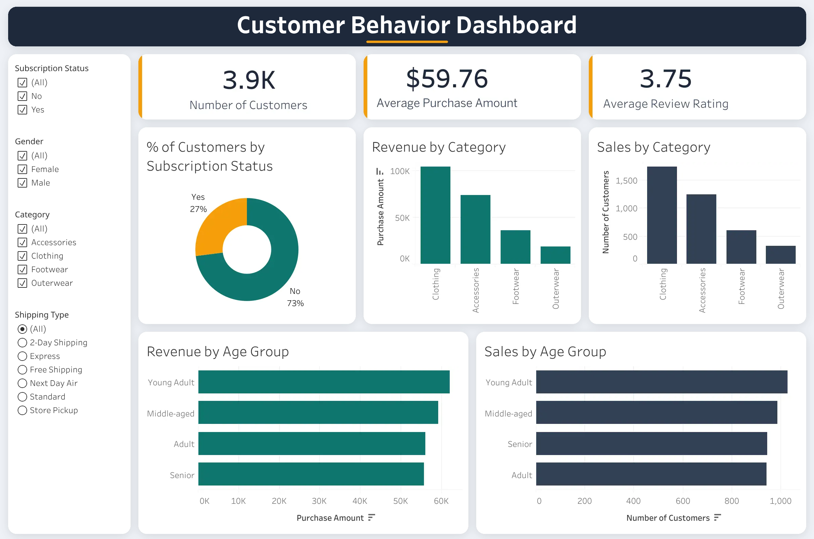
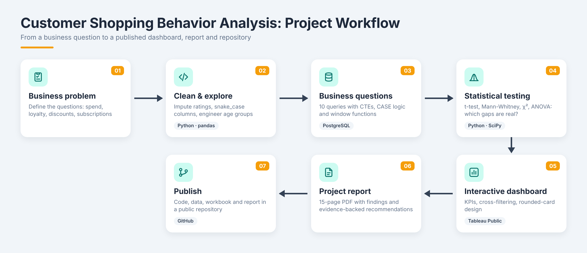
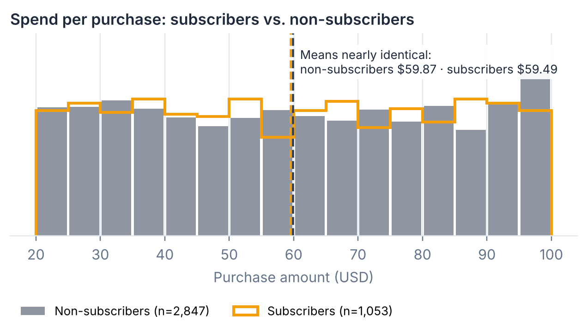
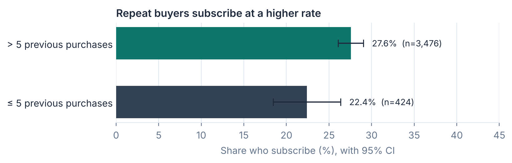
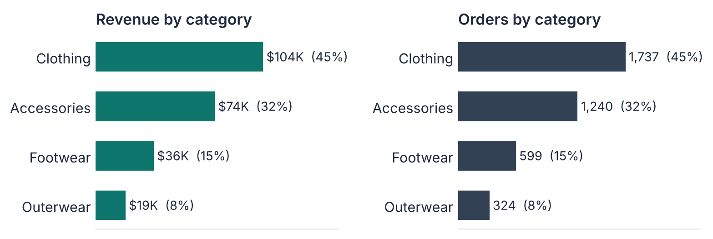

# Customer Shopping Behavior Analysis

**An end-to-end retail analytics project on 3,900 customers:** cleaning in Python, answering 10 business questions in PostgreSQL, checking which differences are statistically real, and presenting it all in an interactive Tableau dashboard.

[](https://public.tableau.com/app/profile/afeef.shaikh/viz/CustomerBehaviorDashboard_17949862787240/CustomerBehaviorDashboard)
[](reports/Customer_Shopping_Behavior_Analysis_Report.pdf)


[](https://public.tableau.com/app/profile/afeef.shaikh/viz/CustomerBehaviorDashboard_17949862787240/CustomerBehaviorDashboard)

<p align="center"><b><a href="https://public.tableau.com/app/profile/afeef.shaikh/viz/CustomerBehaviorDashboard_17949862787240/CustomerBehaviorDashboard">▶ Open the interactive dashboard on Tableau Public</a></b> · <b><a href="reports/Customer_Shopping_Behavior_Analysis_Report.pdf">📄 Read the full 15-page report</a></b></p>

---

## Contents
1. [Business problem](#business-problem)
2. [Workflow](#workflow)
3. [Key findings](#key-findings)
4. [Dataset](#dataset)
5. [Data preparation (Python)](#data-preparation-python)
6. [Business questions (SQL)](#business-questions-sql)
7. [Statistical testing](#statistical-testing)
8. [Dashboard (Tableau)](#dashboard-tableau)
9. [Recommendations](#recommendations)
10. [Repository structure](#repository-structure)
11. [How to run it](#how-to-run-it)
12. [Limitations](#limitations)

---

## Business problem
A retailer wants to understand how its customers shop: what they buy, how much they spend, and how **discounts, subscriptions and shipping choices** relate to spending and loyalty. The goal is to turn this into recommendations the business can act on.

## Workflow


| Step | Tool | What happens | Output |
|---|---|---|---|
| 01 Business problem | — | Define the questions about spend, loyalty, discounts and subscriptions | [Business problem](#business-problem) |
| 02 Clean & explore | Python (pandas) | Impute missing ratings, standardize columns, engineer features | [Notebook](notebooks/Customer_Shopping_Behavior_Analysis.ipynb) |
| 03 Business questions | PostgreSQL | Load the clean table and answer 10 questions in SQL | [SQL file](sql/customer_behavior_queries.sql) |
| 04 Statistical testing | Python (SciPy) | Check which differences are real, not noise | [Results](#statistical-testing) |
| 05 Interactive dashboard | Tableau Public | KPIs, charts and cross-filtering | [Live dashboard](https://public.tableau.com/app/profile/afeef.shaikh/viz/CustomerBehaviorDashboard_17949862787240/CustomerBehaviorDashboard) |
| 06 Project report | PDF | Findings, evidence and recommendations for stakeholders | [Report](reports/Customer_Shopping_Behavior_Analysis_Report.pdf) |
| 07 Publish | GitHub | Code, data, workbook and report in one place | This repository |

## Key findings

| | Finding | Evidence |
|---|---|---|
| 1 | **Clothing and Accessories drive 77% of revenue** | $104,264 and $74,200 of $233,081 total |
| 2 | **Subscribers do *not* spend more per purchase** | $59.49 vs. $59.87; Welch's t-test p = 0.66, Cohen's d = −0.016 |
| 3 | **Repeat buyers are more likely to subscribe** | 27.6% vs. 22.4% subscription rate; χ² = 4.84, p = 0.028 |
| 4 | **Discounts don't raise order value** | 43% of orders are discounted; $59.28 vs. $60.13 at full price, p = 0.27 |
| 5 | **Gender, age and shipping gaps are about headcount, not spending** | Spend per purchase doesn't differ significantly by gender (p = 0.38), age group (ANOVA p = 0.57) or Express vs. Standard shipping (p = 0.13) |

<p>
  
  
</p>

## Dataset
- **3,900 rows × 18 columns**, one row per purchase (each customer appears once). [`data/customer_shopping_behavior.csv`](data/customer_shopping_behavior.csv)
- **Customer demographics:** age, gender, location (50 US states), subscription status
- **Purchase details:** item (25 products), category, purchase amount ($20–$100), season, size, color
- **Shopping behavior:** discount applied, promo code used, previous purchases, purchase frequency, review rating, shipping type, payment method
- **Data quality:** only 37 missing values (0.9%), all in `Review Rating`

## Data preparation (Python)
Notebook: [`notebooks/Customer_Shopping_Behavior_Analysis.ipynb`](notebooks/Customer_Shopping_Behavior_Analysis.ipynb)

- **Missing ratings:** filled with the **median rating of each product category**, not one global average, so no rows are lost.
- **Column names:** converted to `snake_case` so the columns can be queried in SQL without quotes.
- **New features:**
  - `age_group`: four equal-sized quartile bins (Young Adult 18–31, Adult 32–44, Middle-aged 45–57, Senior 58–70)
  - `purchase_frequency_days`: text frequencies such as "Fortnightly" mapped to a number of days
- **Redundancy check:** `promo_code_used` matched `discount_applied` on all 3,900 rows, so it was dropped.
- **Database load:** the clean DataFrame was written to PostgreSQL with SQLAlchemy.

## Business questions (SQL)
All queries: [`sql/customer_behavior_queries.sql`](sql/customer_behavior_queries.sql)

| # | Question | Answer |
|---|---|---|
| Q1 | Revenue by gender | Male $157,890 · Female $75,191, driven by customer count (68% male), not spend |
| Q2 | Discount users who still spent above average | 839 customers, $66,942 in revenue |
| Q3 | Top 5 products by rating | Gloves 3.86 · Sandals 3.84 · Boots 3.82 · Hat 3.80 · Skirt 3.78 |
| Q4 | Express vs. Standard shipping spend | $60.48 vs. $58.46, not statistically significant |
| Q5 | Subscribers vs. non-subscribers | 1,053 subscribers at $59.49 avg. vs. 2,847 non-subscribers at $59.87 |
| Q6 | Most discount-dependent products | Hat 50.0% · Sneakers 49.7% · Coat 49.1% · Sweater 48.2% · Pants 47.4% |
| Q7 | Customer segments | Loyal 3,116 (80%) · Returning 701 (18%) · New 83 (2%) |
| Q8 | Top 3 products per category | Jewelry, Blouse, Pants lead with 171 orders each |
| Q9 | Repeat buyers (>5 purchases) who subscribe | 958 of 3,476 (27.6%) |
| Q10 | Revenue by age group | Young Adult $62,143 · Middle-aged $59,197 · Adult $55,978 · Senior $55,763 |

Techniques used: aggregations, subqueries, `CASE` logic, CTEs and window functions (`ROW_NUMBER() OVER (PARTITION BY …)`).



## Statistical testing
SQL shows differences in averages, but a small gap across 3,900 rows can be noise. These tests check which gaps are real (α = 0.05):

| Question | Test | Result |
|---|---|---|
| Do subscribers spend more per purchase? | Welch's t-test + Mann-Whitney U, 95% CI, Cohen's d | **No.** Difference −$0.37 (CI −$2.04 to $1.29), p = 0.66 |
| Are repeat buyers more likely to subscribe? | Chi-square test of independence | **Yes.** 27.6% vs. 22.4%, p = 0.028 |
| Express vs. Standard shipping spend | Welch's t-test | Not significant, p = 0.13 |
| Discounted vs. full-price order value | Welch's t-test | Not significant, p = 0.27 |
| Spend across age groups | One-way ANOVA | Not significant, p = 0.57 |

## Dashboard (Tableau)
**Live:** [Customer Behavior Dashboard on Tableau Public](https://public.tableau.com/app/profile/afeef.shaikh/viz/CustomerBehaviorDashboard_17949862787240/CustomerBehaviorDashboard) · **Workbook:** [`dashboard/customer_behavior_dashboard.twbx`](dashboard/customer_behavior_dashboard.twbx)

- **KPI cards:** number of customers (3.9K), average purchase amount ($59.76), average review rating (3.75)
- **Charts:** subscription split (donut), revenue and order volume by category, revenue and order volume by age group
- **Filters:** subscription status, gender, category and shipping type, each applied to every worksheet so one click re-slices the whole page
- **Design:** rounded cards with soft shadows; teal for revenue, slate for order volume, amber for accents

## Recommendations
1. **Sell the subscription on loyalty, not bigger baskets.** Subscribers don't spend more per order, so promote convenience and retention perks instead.
2. **Target subscription offers at customers with 5+ purchases.** They already subscribe at a higher rate (27.6% vs. 22.4%).
3. **Review the discount program.** 43% of orders are discounted with no lift in order value. A/B test smaller discounts, starting with Hat, Sneakers and Coat.
4. **Prioritize Clothing and Accessories** (77% of revenue) and feature the best sellers: Jewelry, Blouse and Pants.
5. **Grow reach with women and find out why none subscribe.** Women are 32% of customers and spend as much per purchase as men, yet the data has zero female subscribers.
6. **Shift effort toward acquisition.** 80% of customers are already Loyal and only 2% are New.

The [full report](reports/Customer_Shopping_Behavior_Analysis_Report.pdf) has the evidence behind each recommendation.

## Repository structure
```
customer-shopping-behavior-analysis/
├── data/
│   ├── customer_shopping_behavior.csv      # raw dataset (3,900 × 18)
│   └── customer_clean.csv                  # cleaned table used by Tableau
├── notebooks/
│   └── Customer_Shopping_Behavior_Analysis.ipynb   # cleaning, DB load, hypothesis tests
├── sql/
│   └── customer_behavior_queries.sql       # 10 business questions (PostgreSQL)
├── dashboard/
│   └── customer_behavior_dashboard.twbx    # packaged Tableau workbook (data + images included)
├── reports/
│   └── Customer_Shopping_Behavior_Analysis_Report.pdf
├── images/                                 # dashboard, workflow diagram and charts
├── requirements.txt
├── LICENSE
└── README.md
```

## How to run it
1. **Clone and install**
   ```bash
   git clone https://github.com/afeef-shaikh/customer-shopping-behavior-analysis.git
   cd customer-shopping-behavior-analysis
   pip install -r requirements.txt
   ```
2. **Create the database** (PostgreSQL 14+):
   ```bash
   createdb customer_behavior
   ```
   Then set the `username` in the notebook's connection cell to your PostgreSQL user.
3. **Run the notebook** from the `notebooks/` folder. It cleans the data, loads it into PostgreSQL, runs the hypothesis tests and exports `data/customer_clean.csv`.
4. **Run the SQL** in [`sql/customer_behavior_queries.sql`](sql/customer_behavior_queries.sql) with pgAdmin or `psql -d customer_behavior -f sql/customer_behavior_queries.sql`.
5. **Open the dashboard** in [Tableau Public](https://www.tableau.com/products/public/download) (free): `dashboard/customer_behavior_dashboard.twbx`. You can also just use the [live version](https://public.tableau.com/app/profile/afeef.shaikh/viz/CustomerBehaviorDashboard_17949862787240/CustomerBehaviorDashboard).

## Limitations
- **No dates:** each customer appears once with no order date, so trends and retention over time can't be measured.
- **Possibly synthetic data:** every subscriber used a discount, there are no female subscribers, and the discount and promo-code columns are identical. These patterns should be confirmed with the data owner.
- **Correlation, not causation:** the findings are observational, so recommendations 2 and 3 should be validated with A/B tests.

## Skills demonstrated
- **Python:** data cleaning, group-wise imputation, feature engineering, database loading with SQLAlchemy
- **SQL:** CTEs, window functions, subqueries and conditional aggregation in PostgreSQL
- **Statistics:** Welch's t-test, Mann-Whitney U, chi-square, one-way ANOVA, confidence intervals and effect sizes
- **Visualization:** interactive Tableau dashboard with global filters, calculated fields and a custom design
- **Communication:** a stakeholder report that ties every recommendation to evidence

## Acknowledgements
Built on the [Customer Shopping Behavior Analysis tutorial by Amlan Mohanty](https://github.com/amlanmohanty1/customer-trends-data-analysis-SQL-Python-PowerBI) (Python + SQL + Power BI). This version adds statistical hypothesis testing, rebuilds the dashboard in Tableau with a custom design, and expands the report with evidence-backed recommendations.

## Author
**Afeef Shaikh** · Master of Computer Science student, Texas A&M University
[Portfolio](https://afeefshaikh.com) · [LinkedIn](https://linkedin.com/in/afeefshaikh) · [GitHub](https://github.com/afeef-shaikh) · [Tableau Public](https://public.tableau.com/app/profile/afeef.shaikh)
